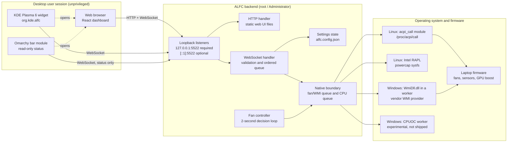
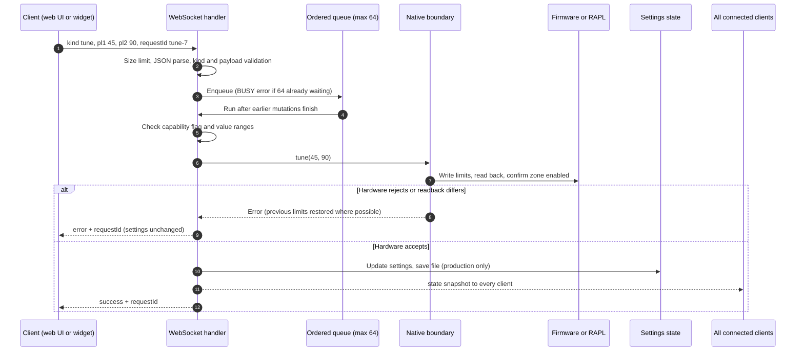
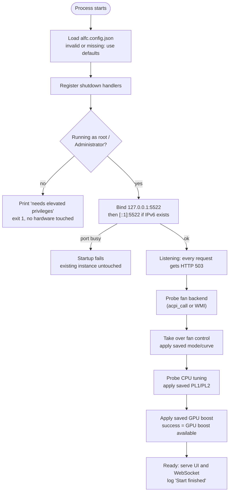
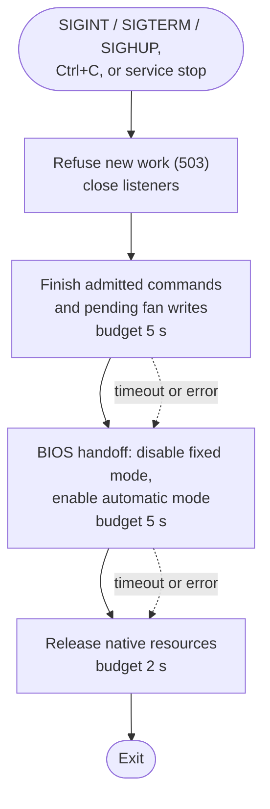

# ALFC architecture

This guide explains what runs where, how the parts cooperate, and how a setting
travels from a client to the laptop firmware and back. It is written for
contributors and for users who want to understand failure messages. Setup
steps live in the platform guides: [LINUX.md](LINUX.md) and
[WINDOWS.md](WINDOWS.md). Day-to-day operation is in [OPERATIONS.md](OPERATIONS.md).

Source paths below are relative to the repository root. They are written as
code rather than links because release archives and installed package
documentation contain the Markdown guides, not the source tree.

## The short version

ALFC is one privileged backend process plus optional unprivileged clients.

- The **backend** is a Bun program. It runs as root on Linux or as an
  Administrator on Windows, because it talks to laptop firmware. It owns all
  hardware access, keeps the authoritative settings, runs the automatic fan
  curve, saves settings to `alfc.config.json`, and serves the web UI.
- The **web UI** is a React app. In a packaged release the backend serves it at
  `http://localhost:5522`. During development Vite serves it on port 3000.
- The **KDE Plasma 6 widget** is a separate QML client installed per desktop
  user. It offers the same primary controls as the web UI.
- The **Omarchy bar module** is a read-only status display that opens the web
  UI when clicked.

Every client talks to the same backend through one local WebSocket endpoint,
`/ws` on port 5522. Clients never touch hardware themselves, and the backend
never trusts a client's idea of the current state: it validates each request,
applies it in order, and broadcasts the resulting state to every client.

## Deployment

Only one platform column is active on a given machine. Linux uses `acpi_call`
for fans, sensors and GPU boost, and Intel RAPL for CPU power limits. Windows
uses the bundled `WmiDll.dll` for fans, sensors and GPU boost. CPU tuning on
Windows is an experimental prototype that standard Windows archives do not
include, so it is normally unavailable.

Nothing listens on a LAN address. Remote access and reverse proxies are
unsupported: the WebSocket API has no login, and the browser origin check
described under [Trust boundary](#trust-boundary) is not authentication.

## Components

| Component                 | Responsibility                                                                                            | Inputs → outputs                                                                            | Depends on                                                                     | State and configuration                                             | When it fails                                                                                                                                                  |
| ------------------------- | --------------------------------------------------------------------------------------------------------- | ------------------------------------------------------------------------------------------- | ------------------------------------------------------------------------------ | ------------------------------------------------------------------- | -------------------------------------------------------------------------------------------------------------------------------------------------------------- |
| Entry point and lifecycle | Permission check, listener startup, hardware initialization, readiness, signal handling, bounded shutdown | Process start and signals → ready listeners, exit code                                      | Every backend module                                                           | Readiness and shutdown flags in memory                              | Missing elevation exits before listening. Startup errors trigger the normal shutdown path, which still attempts BIOS restoration.                              |
| Listeners and HTTP        | Bind `127.0.0.1:5522` and optionally `[::1]:5522`; serve web UI files; accept `/ws` upgrades              | HTTP requests → static files, WebSocket upgrades, 403/405/503 responses                     | Bun's HTTP server                                                              | None                                                                | A busy port stops startup before any hardware call, so a second copy cannot disturb a running one.                                                             |
| WebSocket handler         | Validate messages, queue mutations in arrival order, reply to the sender, broadcast state and telemetry   | Client JSON → `success`/`error` replies, `state` broadcasts, `fancontrolactivity` telemetry | Shared validation in `common/`, state module, fan controller, native boundary  | At most 64 queued messages across all clients                       | Invalid input gets an error reply. A full queue answers `BUSY`. A slow client that builds up 1 MiB of unsent output is disconnected.                           |
| Settings state            | Hold the authoritative settings and save them in order                                                    | Accepted mutations → in-memory state, atomic file write                                     | `common/validation.ts`                                                         | `alfc.config.json`; capability flags are memory-only                | An invalid or unreadable file falls back to built-in defaults. A failed save keeps the new setting active and tells the client it was not saved.               |
| Fan controller            | Run the automatic curve or fixed speed, publish telemetry, hand control back to the BIOS on shutdown      | Settings and temperature readings → paired fan writes, telemetry                            | Native boundary                                                                | Ramp history and last confirmed output in memory                    | Failed sensor reads in automatic mode command the highest configured speed. A failed write marks output unconfirmed. Losing the native channel stops the loop. |
| Native boundary           | Serialize hardware calls, detect capabilities independently, isolate Windows FFI in workers               | Method calls → numeric results or errors; capability flags                                  | Linux `acpi_call` and sysfs, or Windows `WmiDll.dll` and an optional CPUOC DLL | Capability flags and `restartRequired` in memory                    | Each capability is probed separately. A permanently failed channel disables only the features it serves and sets `restartRequired`.                            |
| Web UI                    | Dashboard for all settings, telemetry and raw diagnostics                                                 | Backend snapshots and telemetry → user commands with request IDs                            | A running backend; a modern browser                                            | Last validated snapshot and unsaved edits in the browser tab        | Shows connecting, reconnecting, stale or invalid states. Disables writes until a fresh snapshot arrives. Never resends interrupted commands.                   |
| Plasma widget             | Panel, tray and desktop client with the primary controls                                                  | Same protocol as the web UI                                                                 | Plasma 6, Qt WebSockets QML, a running backend                                 | Widget settings in the user's Plasma configuration                  | Same rules as the web UI. Removing or breaking the widget does not affect the backend.                                                                         |
| Omarchy module            | Read-only status in the Omarchy bar, plus a launcher for the web UI                                       | Snapshots and telemetry → status label; click → browser                                     | Omarchy 4.0.4 Quickshell, Qt WebSockets QML, a running backend                 | Inline entry in the user's `~/.config/omarchy/shell.json`           | Shows offline, stale or error states. It sends no hardware commands, so its failure cannot change fan behavior.                                                |
| Service wrappers          | Start the backend at boot and stop it within a time limit                                                 | Service manager events → process start/stop                                                 | systemd or OpenRC on Linux; WinSW and the Windows Service Control Manager      | Unit/registration files; Windows wrapper logs beside the executable | A failed stop makes install or uninstall abort without replacing files.                                                                                        |

### Where the code lives

| Area                                  | Main files                                                                                       |
| ------------------------------------- | ------------------------------------------------------------------------------------------------ |
| Entry point, readiness, shutdown      | `server/index.ts`                                                                                |
| Loopback listeners                    | `server/listeners.ts`                                                                            |
| HTTP, static files, origin check      | `server/http.ts`                                                                                 |
| Permission check                      | `server/permissions.ts`                                                                          |
| Source versus compiled paths          | `server/utils/consts.ts`                                                                         |
| WebSocket handling and broadcasting   | `server/websocket/index.ts`                                                                      |
| Settings state and persistence        | `server/state/index.ts`                                                                          |
| Fan loop, ramping, BIOS restoration   | `server/fan-control/index.ts`                                                                    |
| Native boundary and capability probes | `server/native/index.ts`                                                                         |
| Linux transports                      | `server/native/linux/acpi.ts` (acpi_call), `server/native/linux/cpuoc.ts` (Intel RAPL)           |
| Windows transports                    | `server/native/windows/` (`hardware.ts`, `hardware.worker.ts`, `acpi.ts`, `cpuoc.ts`, `wmidll/`) |
| Shared types, validation, catalog     | `common/types.ts`, `common/protocol.ts`, `common/validation.ts`, `common/methods.ts`             |
| Web UI                                | `frontend/src/` (connection logic in `frontend/src/utils/`)                                      |
| Plasma widget                         | `plasmoid/package/contents/ui/` (`BackendConnection.qml`, `Protocol.js`)                         |
| Omarchy module                        | `omarchy/module/`, installer `omarchy/manage.py`                                                 |
| Service scripts                       | `bootstrap/scripts/` (Windows) and `bootstrap/scripts/linux/`                                    |
| Arch package template                 | `aur/`                                                                                           |

Nested contributor notes in `server/AGENTS.md`, `server/native/AGENTS.md` and
`bootstrap/AGENTS.md` record the detailed contracts for those areas.

## Three different facts: saved, commanded, measured

ALFC keeps three kinds of information apart. Mixing them up is the most common
way to misread the UI.

| Fact                     | Where it comes from                                                                                                                                                                           | What it does **not** prove                                             |
| ------------------------ | --------------------------------------------------------------------------------------------------------------------------------------------------------------------------------------------- | ---------------------------------------------------------------------- |
| **Saved settings**       | The `state` snapshot: fan curves, fixed mode and percentage, GPU boost, PL1/PL2. Production saves them to `alfc.config.json`.                                                                 | That the fans are currently at any particular speed.                   |
| **Acknowledged command** | `appliedSpeed` in `fancontrolactivity` telemetry: the last paired fan write the firmware accepted. `null` means the last write is unconfirmed. `target` is what the controller is aiming for. | That a fan physically reached that speed. ALFC does not read RPM.      |
| **Measured readings**    | `avgCPUTemp` and `avgGPUTemp` in telemetry. With `sensorFailure: true` they are the last good readings, not current ones.                                                                     | Anything once telemetry is more than ten seconds old (shown as stale). |

A "success" reply to a fan-curve change therefore means the backend validated
and accepted the curve (and, in production, saved it). It does not mean a fan
changed speed.

## Tracing a setting from client to firmware

The example below changes CPU power limits (wire message
`{"kind":"tune","data":{"pl1":45,"pl2":90},"requestId":"tune-7"}`), which
exercises every layer. Fan
mode, fixed percentage and GPU boost follow the same path. A fan-curve change
skips the hardware call because the fan loop reads the new curve on its next
cycle.

Step by step:

1. **Client.** The web UI (`frontend/src/utils/backendRequests.ts`) or widget
   (`BackendConnection.qml`) sends JSON with a unique `requestId`. It refuses to
   send unless its current connection has delivered a validated snapshot.
2. **Validation.** `server/websocket/index.ts` rejects messages over 64 KiB,
   invalid JSON, unknown kinds and malformed payloads before they reach the
   queue. Value rules come from `common/validation.ts`. The same rules check
   incoming snapshots in the web UI (through `common/protocol.ts`) and in the
   widget's `Protocol.js` copy; the editors also check input before sending.
3. **Ordering.** One queue serves both listeners and all clients, so two
   clients cannot interleave hardware writes. Plain `ping` and the telemetry
   subscription bypass the queue.
4. **Capability and range checks.** A request for a capability the backend
   marked unavailable is rejected without touching hardware.
5. **Hardware.** `server/native/index.ts` runs the call on the correct queue.
   Fan and WMI calls share one serialized queue; CPU tuning has its own, so a
   stuck CPU call cannot block fan control. Method IDs, argument order and
   widths come from the shared catalog in `common/methods.ts`.
6. **State and persistence.** Only after the hardware accepts the change does
   the in-memory state change. `server/state/index.ts` then writes the settings
   to a temporary file and renames it over `alfc.config.json`. Saves happen one
   at a time. Development runs skip saving entirely.
7. **Broadcast and reply.** Every client on both listeners receives the new
   `state` snapshot, then the requester receives `success` with its
   `requestId`. If saving failed, the new setting stays active, the snapshot is
   still broadcast, and the requester receives a `PERSISTENCE_ERROR`.
8. **Clients update.** Each client replaces its displayed settings with the
   snapshot. Unsaved edits to unrelated fields are kept; a field the server
   changed is refreshed.

Replies are matched only by `requestId`, so one client never completes
another client's pending action. If the connection drops before a reply,
the client reports the action as unconfirmed and does **not** resend it,
because the hardware may already have applied it. The wire format, error codes
and limits are specified in [common/PROTOCOL.md](common/PROTOCOL.md).

## Startup and readiness

Key points:

- **Listeners come before hardware.** If port 5522 is already taken (usually by
  a running service), the new process exits before it changes anything. If
  the IPv6 loopback address is missing from the system, ALFC continues on IPv4
  only. If IPv6 exists but its port is busy, startup fails rather than leaving
  clients connected to two different services.
- **HTTP 503 until ready.** While hardware initializes, page loads and
  WebSocket upgrades receive `503 Service Unavailable`. Clients keep retrying.
- **Capabilities are independent.** Fan control, CPU tuning and GPU boost are
  each probed and reported separately. On Linux, fan control needs
  `/proc/acpi/call`; CPU tuning needs a writable, enabled Intel RAPL package
  zone. On Windows, fan control and GPU boost need the vendor WMI provider; CPU
  tuning needs the optional CPUOC DLL, which standard archives omit.
- **Startup applies saved settings.** The saved fan mode, power limits and GPU
  boost value are applied during initialization. Review `alfc.config.json`
  before the first start; see [OPERATIONS.md](OPERATIONS.md#configuration).
- **Capability results are cached.** Loading `acpi_call` after ALFC started does
  not enable fan control until ALFC restarts.
- **Readiness log.** The backend prints
  `[Server] Start finished - UI available @ http://localhost:5522` when it is
  ready.

If fan initialization fails partway, ALFC first tries to give control back to
the BIOS. If that handoff also fails, startup is aborted so the shutdown path
retries it, rather than leaving fans in an unmonitored manual mode.

## Shutdown and BIOS handoff

- Both BIOS commands (`SetFixedFanStatus 0` and `SetAutoFanStatus 1`) are
  attempted even if earlier steps failed.
- The whole sequence has a hard 12-second deadline. systemd, OpenRC and WinSW
  allow 15 seconds before force-killing the process.
- A hung firmware or driver call cannot be cancelled. If the handoff fails or
  times out, the log says so. Forced termination can leave the last manual fan
  command in effect; start ALFC again and stop it normally to retry the
  handoff.

## Fan control in brief

- Automatic mode reads temperatures several times per two-second cycle,
  looks up the CPU and GPU curves, and applies the **higher** target to both
  fans with one paired write.
- Curves are threshold steps, not interpolation: each point's speed applies
  from its temperature up to the next point. Temperatures below the first
  point use the first point's speed.
- An increase starts on the next qualifying cycle. A decrease waits for about
  30 qualifying cycles (roughly a minute). Each change moves halfway toward the
  target and jumps straight to it once within five percentage points.
- Until the first valid reading arrives, automatic mode uses the highest speed
  in the curves. If sensor reads fail, automatic mode commands the highest
  configured speed and fixed mode keeps its configured speed.
- Fixed mode applies the configured percentage. Saving a fixed percentage while
  in automatic mode stores it without switching modes.
- A manual fan command resets the ramp history, including a quick
  fixed-to-automatic switch between samples.
- Every five minutes the controller reasserts its manual fan mode, so firmware
  that silently reverts is brought back under control.

## Persistence and paths

| Running as                                        | Config file                              | Web UI files                       | Saves settings? |
| ------------------------------------------------- | ---------------------------------------- | ---------------------------------- | --------------- |
| Packaged executable (`alfc` / `alfc.exe`)         | `alfc.config.json` beside the executable | `frontend/` beside the executable  | Yes             |
| Source with `NODE_ENV=production`                 | Repository `alfc.config.json`            | `frontend/build/` (build it first) | Yes             |
| Source development (`bun run --cwd server start`) | Repository `alfc.config.json`            | Not served; use Vite on port 3000  | No              |

The code decides between packaged and source paths by checking whether it is
running as a compiled Bun executable (`server/utils/consts.ts`), not from
`NODE_ENV`. `NODE_ENV` only selects development behavior. The service files and
`run.sh`/`run.bat` set `NODE_ENV=production`.

Only the seven settings fields are saved. Capability flags
(`isFanControlAvailable`, `isGpuBoostAvailable`, `isCpuTuningAvailable`) and
`restartRequired` describe the running machine; they are recomputed at every
start and ignored if present in the file. On Linux, a missing configuration
file is created with mode `0600`; later saves keep the existing file's
permissions.

Typical installed locations:

| Installation                | Executable and config                                            |
| --------------------------- | ---------------------------------------------------------------- |
| Manual Linux (`install.sh`) | `/opt/alfc/`                                                     |
| Arch package (template)     | `/usr/lib/alfc/`                                                 |
| Windows                     | The folder where you extracted the release and ran `install.bat` |

## Trust boundary

- The backend runs with full privileges and accepts commands from any local
  process that can reach `127.0.0.1:5522` or `[::1]:5522`.
- Browser WebSocket connections must come from a loopback `http`/`https`
  origin (`localhost`, `127.0.0.1` or `[::1]`, any port). This stops ordinary
  websites from driving the API through your browser. It is **not**
  authentication: native programs send no origin and are accepted, and any
  other service hosted on a loopback origin is trusted too.
- Protect the installation directory and `alfc.config.json` from unprivileged
  modification; the backend executes and loads them as root/Administrator.
- Raw diagnostics in the web UI can call firmware methods directly. Setters
  that would fight the fan controller are blocked.

See [SECURITY.md](SECURITY.md) for reporting and the full list of trust
boundaries.

## Build and release outputs

`bun run build` compiles the frontend and a standalone backend executable that
embeds Bun. End users never install Bun or Node. The root `build.sh` (Linux) and
`build.bat` (Windows) assemble a complete release folder. The tag-driven
release workflow builds the published archives. Each archive contains:

- the executable (`alfc` or `alfc.exe`), `frontend/`, and the default
  `alfc.config.json`;
- service scripts (`install`, `uninstall`, `run`);
- on Windows, `WmiDll.dll`, the WinSW wrapper `alfc-service.exe` with its XML
  and license;
- on Linux, the Plasma widget package and its install/uninstall helpers;
- the Omarchy module and helpers (with the widget's `Protocol.js`, which the
  module reuses);
- root, `common/`, `plasmoid/` and `aur/` Markdown documentation.

A separate `org.kde.alfc.plasmoid` release asset packages the widget alone.

[RELEASING.md](RELEASING.md) covers the release process and its manual gates.

## Testing without hardware

| Layer                                         | How it is tested                                                                                                      | What it cannot show                  |
| --------------------------------------------- | --------------------------------------------------------------------------------------------------------------------- | ------------------------------------ |
| Shared validation, state, WebSocket, fan loop | Vitest with the native boundary mocked (`bun run test`)                                                               | Real firmware behavior               |
| Listeners, startup order, shutdown            | Real Bun subprocesses and sockets with hardware fixtures                                                              | Service-manager integration          |
| Web UI                                        | Chromium scenarios with a controlled WebSocket peer (`bun run test:web`)                                              | A real backend                       |
| Cross-client protocol                         | Built web UI and real QML transport against production handlers with fake Linux adapters (`bun run test:integration`) | Windows, firmware, Plasma shell      |
| Plasma and Omarchy QML                        | Qt-only and matching distro Qt/KDE component tests                                                                    | A full desktop session               |
| Windows WMI DLL                               | Output-packing tests anywhere; MSVC build and COM tests in Windows CI                                                 | Vendor WMI provider on a laptop      |
| Service scripts                               | Real scripts with filesystem targets and service commands redirected to temporary fixtures                            | Real systemd/OpenRC/SCM/UAC behavior |

The production permission check is never bypassed in tests. Fixtures replace
the hardware boundary instead. [CONTRIBUTING.md](CONTRIBUTING.md) lists the
commands, and [integration/README.md](https://github.com/ThatMarko/alfc/blob/master/integration/README.md)
describes the cross-client tier.

Physical laptop behavior, real Windows UAC/SCM integration, and full Plasma and
Omarchy sessions are manual release gates. Historical results are recorded in
[MAINTENANCE_REVIEW.md](MAINTENANCE_REVIEW.md) and
[PORTING_REVIEW.md](PORTING_REVIEW.md).
