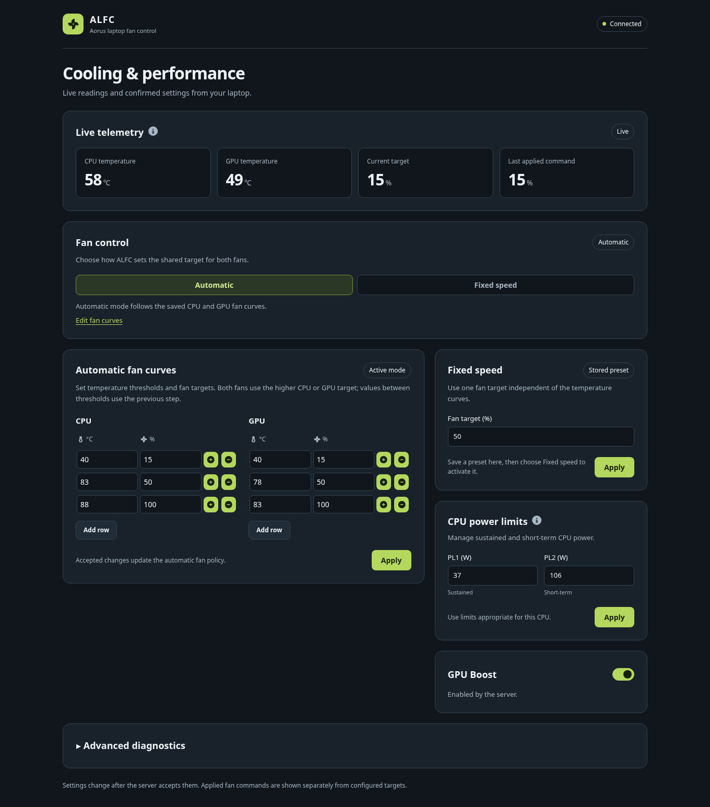

# Operating ALFC

This guide covers everyday use on both Linux and Windows: configuration, what
a healthy start looks like, how to read the dashboard, and how to diagnose
problems. Install, upgrade and removal steps are platform-specific: see
[LINUX.md](LINUX.md) or [WINDOWS.md](WINDOWS.md). For how the pieces fit
together, see [ARCHITECTURE.md](ARCHITECTURE.md).

## Before the first start

1. **Confirm your laptop is a candidate.** ALFC is for compatible Gigabyte
   Aorus/Aero laptops. Read the [hardware notes](README.md#hardware-and-platform-support).
   No model is certified.
2. **Choose one fan controller.** Stop other fan-control tools (vendor control
   centers, `fancontrol`, NBFC and similar) that write the same firmware
   controls. ALFC does not disable them for you.
3. **Review the configuration.** Startup applies the saved fan mode, GPU boost
   setting and CPU power limits automatically. The shipped 37 W / 106 W limits
   are historical defaults from the original project, not recommendations for
   your CPU. See [Configuration](#configuration).

## Configuration

Settings live in one JSON file, `alfc.config.json`, beside the executable:

| Installation                         | File                                                                          |
| ------------------------------------ | ----------------------------------------------------------------------------- |
| Manual Linux install                 | `/opt/alfc/alfc.config.json`                                                  |
| Arch package (template)              | `/usr/lib/alfc/alfc.config.json`                                              |
| Windows                              | `alfc.config.json` in the release folder where you ran `install.bat`          |
| Temporary run (`run.sh` / `run.bat`) | `alfc.config.json` in the extracted release folder                            |
| Source checkout                      | `alfc.config.json` at the repository root (development runs never save to it) |

You normally change settings from the web UI or the Plasma widget; changes are
validated, applied and saved immediately. To edit the file by hand, stop the
service first, make a backup, edit, then start the service again. The running
service does not reread the file, and its next save would overwrite your edit.

| Field             | Meaning                                                                  | Allowed values                                                                                           | Default                      |
| ----------------- | ------------------------------------------------------------------------ | -------------------------------------------------------------------------------------------------------- | ---------------------------- |
| `cpuFanTable`     | Automatic-mode curve driven by CPU temperature                           | Non-empty list of `[temperature °C, fan %]` pairs; temperatures 0–110 and strictly increasing; fan 0–100 | `[[40,15],[83,50],[88,100]]` |
| `gpuFanTable`     | Automatic-mode curve driven by GPU temperature                           | Same as `cpuFanTable`                                                                                    | `[[40,15],[78,50],[83,100]]` |
| `doFixedSpeed`    | `true` = fixed mode, `false` = automatic curves                          | `true` or `false`                                                                                        | `false`                      |
| `fixedPercentage` | Fan speed used in fixed mode                                             | Whole number 0–100                                                                                       | `50`                         |
| `gpuBoost`        | GPU boost setting applied at startup when the laptop supports it         | `true` or `false`                                                                                        | `true`                       |
| `pl1`             | Long-term CPU power limit in watts, applied when CPU tuning is available | Whole number 0–200                                                                                       | `37`                         |
| `pl2`             | Short-term CPU power limit in watts                                      | Whole number 0–200                                                                                       | `106`                        |

How curves work: both fans follow whichever curve asks for more. Each point's
speed applies from its temperature up to the next point (and below the first
point, the first point's speed applies); there is no blending between points.
In automatic mode, increases step up immediately and decreases wait roughly a
minute per step, moving halfway toward the target each time. The accepted ranges are input checks, not safety ratings for
your hardware. Excessive power limits increase heat and power draw; low limits
reduce performance.

If any field is invalid or the file cannot be parsed, ALFC logs
`[State] Corrupt or invalid config detected, using defaults.` (or
`Failed to load config, using defaults`) and runs with **all** defaults. The
next change made in a client then saves a complete new file, replacing the
broken one. Keep a backup if you edit by hand.

Other fields in the file are ignored. Capability fields such as
`isFanControlAvailable` are never read from the file; they are detected at
every start.

## What a healthy start looks like

The backend prints progress to its console, which ends up in the platform's
log (see [Logs](#logs)). A successful start looks similar to this:

```text
[Server] Checking permissions...
[Server] Starting server...
[Server] Initializing fan control...
[FanControl] Starting fan control monitoring...
[Native] Initializing CPU tuning...
[Native] Trying to set initial CPU tuning...
[Native] CPU tuning initialized successfully.
[Native] Setting GPU boost...
[Native] Initialization complete.
[Server] Start finished - UI available @ http://localhost:5522
```

On Windows, `[Native] Initializing WMI...` appears before fan monitoring
starts. Warnings such as `[Native] CPU tuning is not available.` mean that
one feature is missing; the others still work. Only the final
`Start finished` line means the UI is ready. Before it, the browser sees
`503 Service Unavailable` and the clients keep retrying.

Then open `http://localhost:5522` (or `http://127.0.0.1:5522`;
`http://[::1]:5522` works when IPv6 is available). The header badge should read
**Connected**, and within a few seconds the **Live telemetry** panel should
show **Live** with current temperatures.

## Reading the dashboard



The screenshot uses simulated readings; it is not a hardware validation
result.

| You see                                                                              | Meaning                                                                                                                                                                | What to do                                                                  |
| ------------------------------------------------------------------------------------ | ---------------------------------------------------------------------------------------------------------------------------------------------------------------------- | --------------------------------------------------------------------------- |
| **Connecting** / "Waiting for server connection"                                     | No backend reachable yet, or it is still initializing                                                                                                                  | Start the service, or wait for `Start finished` in the log                  |
| **Reconnecting**                                                                     | The connection dropped. The last confirmed settings stay visible and your edits are kept, but changes are disabled                                                     | Wait; the page reconnects automatically                                     |
| **Invalid response**                                                                 | The backend sent a snapshot this UI cannot use (for example, an incompatible protocol version)                                                                         | Use matching ALFC backend and client versions                               |
| **Live**                                                                             | Telemetry is current                                                                                                                                                   | —                                                                           |
| **Offline**                                                                          | The telemetry panel is not connected to the backend                                                                                                                    | Same as **Connecting** / **Reconnecting** above                             |
| **Waiting for readings**                                                             | Connected, but no telemetry has arrived yet                                                                                                                            | Normal for a few seconds after connecting                                   |
| **Stale**                                                                            | No valid telemetry for ten seconds while fan control is expected to work (including when every sensor read has failed since startup)                                   | Check the backend log; restart the service if it persists                   |
| **Sensor error**                                                                     | After at least one good reading, the latest temperature read failed. Shown temperatures are the last good values; automatic mode commands the highest configured speed | Check the log for sensor errors                                             |
| **Last applied command: Unconfirmed**                                                | The last paired fan write in a telemetry packet was not confirmed by the firmware                                                                                      | Check the log; the next successful write clears it                          |
| **Unavailable** / "Fan control is not available on this system"                      | The backend could not start fan control                                                                                                                                | See [Diagnosing an unavailable feature](#diagnosing-an-unavailable-feature) |
| "A native service stopped responding. Restart ALFC to restore unavailable features." | A hardware channel failed permanently while running. Unaffected features keep working                                                                                  | Restart the ALFC service                                                    |

"Current target" is what the fan controller is aiming for. "Last applied
command" is the last fan speed the firmware accepted. Neither is a measured
fan speed: ALFC does not read RPM. A "Change accepted" message means the
backend validated the setting, ran any immediate hardware call (fan curves
and an inactive fixed preset wait until their mode uses them), and saved it
in production. It does not mean the fans have already changed speed.

The web UI keeps unsaved edits through reconnects. If another client changes
the same field, the new value replaces your draft. If a connection drops while
a change is pending, the UI reports it as unconfirmed and does **not** resend
it. Check the displayed settings and apply it again if needed.

The collapsed **Advanced diagnostics** section offers raw firmware calls. They call firmware
methods directly with root/Administrator rights. Use them only if you know
what a method does. Fan setters are blocked there so they cannot fight the fan
controller.

The web UI checks GitHub for a newer ALFC release when the page loads and
every 12 hours, with a ten-second deadline. Failures only affect the update notice.
There is no setting to turn the check off. Hardware control never needs
Internet access.

## Diagnosing an unavailable feature

ALFC detects fan control, CPU tuning and GPU boost separately at startup. A
missing feature does not mean the others failed. Detection happens once per
start: after fixing a cause, **restart the ALFC service**.

| Feature missing  | Linux checks                                                                                                                                                                                                  | Windows checks                                                                                                                                                      |
| ---------------- | ------------------------------------------------------------------------------------------------------------------------------------------------------------------------------------------------------------- | ------------------------------------------------------------------------------------------------------------------------------------------------------------------- |
| Fan control      | Does `/proc/acpi/call` exist? Is the `acpi_call` module built for the running kernel and loaded? Was it loaded before ALFC started? Does the firmware expose the expected methods?                            | Is the vendor WMI provider present (see [WINDOWS.md](WINDOWS.md#troubleshooting))? Is `WmiDll.dll` beside `alfc.exe`? Look for `WMI init attempt` lines in the log. |
| GPU boost        | Requires an available ACPI/WMI backend (`acpi_call` on Linux, `WmiDll.dll` on Windows) and a firmware method that accepts the saved setting; managed fan control can fail independently. Many models lack it. | Same as Linux.                                                                                                                                                      |
| CPU power limits | Is there an Intel RAPL package zone under `/sys/class/powercap/` with `enabled` equal to `1`? ALFC never enables a disabled zone, and it manages only the first Intel package zone.                           | Expected: standard Windows archives do not include the experimental CPU-tuning component.                                                                           |

## Logs

| How ALFC runs                 | Where output goes                                                                                                                                 |
| ----------------------------- | ------------------------------------------------------------------------------------------------------------------------------------------------- |
| Linux systemd service         | `journalctl -u alfc -f` (status: `systemctl status alfc`)                                                                                         |
| Linux OpenRC service          | Not captured to a file. Stop the service and use `sudo ./run.sh` to see output                                                                    |
| Windows service               | `alfc-service.out.log`, `alfc-service.err.log` (each rotated at 10 MiB, eight rolled files kept) and `alfc-service.wrapper.log` beside `alfc.exe` |
| `run.sh`, `run.bat` or source | The terminal                                                                                                                                      |

When asking for help, include the log from start to `Start finished` (or to
the first error), the ALFC version or commit, your laptop model, OS and
firmware version. Remove anything personal first.

## Troubleshooting

| Symptom                                                   | Likely cause and fix                                                                                                                                                                                                                               |
| --------------------------------------------------------- | -------------------------------------------------------------------------------------------------------------------------------------------------------------------------------------------------------------------------------------------------- |
| "This needs to be run with elevated privileges." and exit | The backend was started without root/Administrator. Use the service, `sudo ./run.sh`, or `run.bat` (which asks for elevation).                                                                                                                     |
| Startup fails with an address-in-use error                | Another ALFC (often the installed service) already owns port 5522. Stop one of them. Never work around it by exposing ALFC on another interface.                                                                                                   |
| `http://localhost:5522` answers `Service Unavailable`     | Initialization is still running, or a hardware call is stuck. Wait for `Start finished` (on Windows, WMI initialization can take up to 20 seconds before timing out).                                                                              |
| Page shows "Nothing to see here."                         | You are running the backend from source in development mode. Use the Vite UI on port 3000, or run a packaged build.                                                                                                                                |
| UI loads but stays on **Connecting**                      | On Vite port 3000, the backend may not be running yet. On port 5522, the WebSocket upgrade was rejected (check the log for `[WebSocket] Origin rejected:` and open `http://localhost:5522` directly) or no valid state arrived within ten seconds. |
| Settings change but are lost after restart                | A `PERSISTENCE_ERROR` was reported: the file or directory is not writable by the service. In source development, saving is intentionally disabled.                                                                                                 |
| Fans stay at a fixed speed after ALFC stopped             | The BIOS handoff did not complete (look for `Failed to restore fan control on exit`). Start ALFC and stop it normally to retry.                                                                                                                    |
| Fan behavior seems to fight itself                        | Another fan controller is active. Choose one owner.                                                                                                                                                                                                |

Platform-specific problems (kernel modules, service managers, Windows
services) are covered in [LINUX.md](LINUX.md#troubleshooting) and
[WINDOWS.md](WINDOWS.md#troubleshooting).

## Upgrades and configuration migration

Upgrades keep your configuration as long as you upgrade in the same place:

- **Manual Linux install:** run the new release's `install.sh`. It stops the
  service, replaces files in `/opt/alfc` and keeps `alfc.config.json`.
- **Arch package:** pacman keeps your edited `alfc.config.json` as a backup
  file. Restart the service after upgrading.
- **Windows:** releases are self-contained folders. To move to a new folder,
  uninstall the service from the **old** folder, copy its `alfc.config.json`
  into the new folder, then install from the new one. See
  [WINDOWS.md](WINDOWS.md#upgrade-or-move-to-a-new-release).

An older file loads if all seven settings fields are present and valid;
otherwise ALFC uses the defaults (see [Configuration](#configuration)).
Capability and restart fields from older files are ignored.

## Desktop integrations

The Plasma widget and the Omarchy module are optional clients that run in your
desktop session. Install them **as your normal desktop user, without `sudo`**.
They need a running backend but do not start, stop or elevate it, and removing
them does not affect fan control.

| Integration              | Guide                                    | Can change settings?  |
| ------------------------ | ---------------------------------------- | --------------------- |
| KDE Plasma 6 widget      | [plasmoid/README.md](plasmoid/README.md) | Yes                   |
| Omarchy 4.0.4 bar module | [OMARCHY.md](OMARCHY.md)                 | No (opens the web UI) |

Both installers use Python 3 for ownership checks so they never overwrite or
remove another package's files.

## What has and has not been verified

Automated tests cover the protocol, clients, service scripts and native
packing with simulated hardware. They do not prove that a particular laptop's
firmware responds correctly, that fans physically change speed, or that the
BIOS handoff works on your machine. Real Windows service-manager behavior and
full Plasma and Omarchy desktop sessions are also checked manually. See
[MAINTENANCE_REVIEW.md](MAINTENANCE_REVIEW.md) for the historical record.
