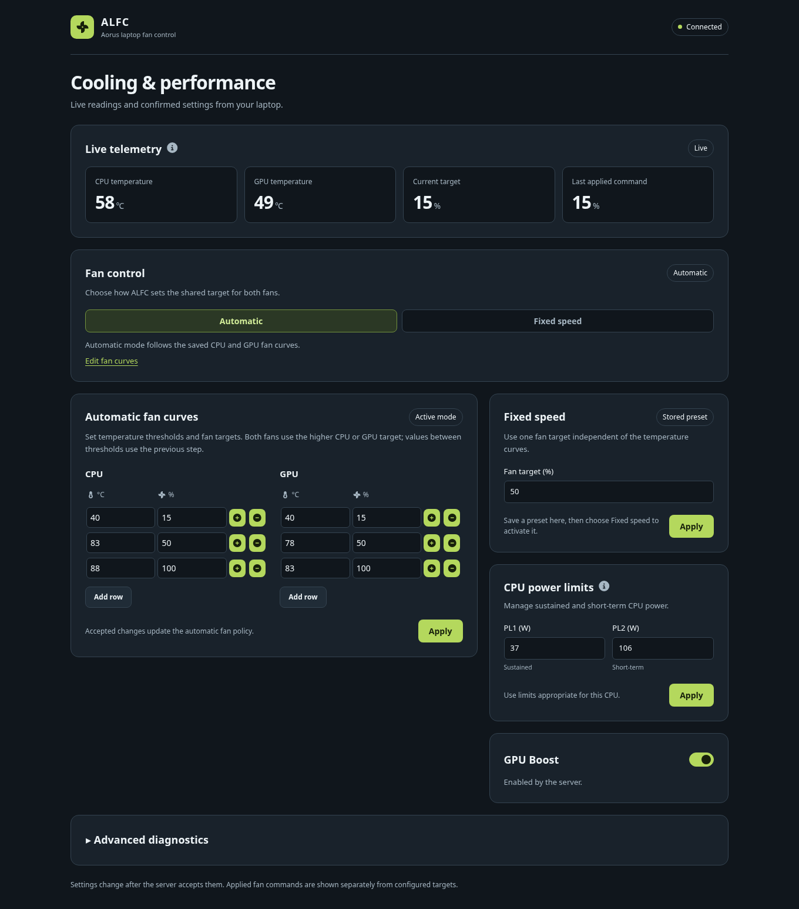

# Aorus Laptop Fan Control (ALFC)

[](https://github.com/ThatMarko/alfc/actions/workflows/ci.yml)
[](LICENSE)

ALFC controls compatible Gigabyte Aorus/Aero laptop fans through a local Bun
backend, a React web UI, an optional KDE Plasma 6 widget, and an Omarchy
status/launcher module. This fork builds
on [Andreas Opferkuch's original project](https://github.com/s-h-a-d-o-w/alfc).
The implementation from [PR #1](https://github.com/ThatMarko/alfc/pull/1) is
merged into the default branch, `master`. Package metadata says `2.0.0`; the
latest published release checked on 2026-10-15 is still the
[v2.0.0-alpha.7 prerelease](https://github.com/ThatMarko/alfc/releases/tag/v2.0.0-alpha.7),
which predates that merge. No stable release or physical compatibility
certification follows from the merge.

## Hardware and platform support

The backend detects fan control, GPU boost, and CPU power tuning separately.
The web UI and widget use those runtime capabilities; a supported fan controller
does not establish CPU-tuning or GPU-boost support.

| Function                          | Linux                                              | Windows                                                               |
| --------------------------------- | -------------------------------------------------- | --------------------------------------------------------------------- |
| Fan control and temperature reads | `acpi_call`, with compatible firmware methods      | ABI 2 `WmiDll.dll`, with compatible vendor WMI provider               |
| GPU boost                         | Supported vendor ACPI method, when detected        | Supported vendor WMI method, when detected                            |
| CPU power limits                  | Writable Intel RAPL constraints, when detected     | Optional experimental CPUOC adapter; not included in release archives |
| Desktop integration               | KDE Plasma 6 widget; Omarchy 4.0.4 status/launcher | Use the web UI                                                        |

The bundled Intel SDK is a legacy managed .NET Framework assembly with additional
XTU/WCF dependencies. Its presence does **not** make the experimental .NET 8
NativeAOT CPUOC adapter deployable. NativeAOT publishing and actual driver
compatibility remain unverified; see [PORTING_REVIEW.md](PORTING_REVIEW.md).
Windows version alone does not determine whether CPU tuning works.

These are historical community reports from earlier ALFC implementations, not
certification of the current native bindings:

| Model        | Fan control reports  | CPU limit reports | GPU boost reports    |
| ------------ | -------------------- | ----------------- | -------------------- |
| Aorus 15G    | Windows 10/11, Linux | Windows 10, Linux | Windows 10/11, Linux |
| Aorus 15G XC | Windows 10, Linux    | Windows 10, Linux | Unconfirmed          |
| Aorus 15P XD | Windows 10           | Windows 10        | Unconfirmed          |
| Aorus 15 FSB | Windows 11           | Unconfirmed       | Unconfirmed          |
| Aorus 5 SE4  | Windows 11           | Unconfirmed       | Unconfirmed          |
| Aero 15 SA   | Windows 10/11, Linux | Unconfirmed       | Unconfirmed          |

Report the exact model, firmware, OS, driver, and ALFC revision when confirming
support. GPU boost methods are particularly model-dependent. Avoid running
multiple fan-control tools against the same firmware at once.

## Operation



The example uses simulated readings; it is not a hardware validation result.

- Open `http://localhost:5522`. Explicit IPv4 loopback (`127.0.0.1`) and available
  IPv6 loopback (`::1`) share the same backend. The service does not listen on
  the LAN, and the WebSocket API has no authentication.
- Automatic mode selects threshold steps from the CPU and GPU fan tables and
  applies the higher target to both fans. The normal decision interval is two
  seconds; temperature collection and hardware latency affect actual timing.
  Startup uses the highest configured target until a valid temperature collection
  selects the first curve target. Later ramp-up needs one qualifying cycle and
  ramp-down needs 30. Manual fan commands reset that cooling history, including
  a quick fixed-to-auto switch between samples.
- The web UI and Plasma widget can save the inactive fixed preset or automatic curves without switching modes. The active mode and the saved settings are shown separately.
- Fixed mode applies the configured percentage. Telemetry distinguishes the
  target from the last confirmed write; an unknown result is not shown as a
  confirmed speed. The clients warn after ten seconds without telemetry, including a missing first reading when monitoring is available.
- Settings change after backend validation and hardware acceptance where a
  hardware call is required. A fan-table acknowledgement means the table was
  accepted (and persisted in production), not that a particular fan speed was
  measured. Unrelated state updates
  preserve unsaved edits. The web dashboard retains edits to unchanged fields through reconnects, refreshes fields changed by the server, disables writes until a fresh snapshot is validated, and keeps interrupted-request errors visible.
- Production settings live in `alfc.config.json` beside the executable
  (`/opt/alfc` for manual Linux installs, `/usr/lib/alfc` for AUR packaging).
  Stop the service before editing it, then restart. Development loads the
  repository config but does not persist UI changes.
- Shutdown attempts to disable fixed control and restore BIOS automatic control.
  Firmware and driver hangs can prevent that handoff; automated tests cannot
  guarantee restoration on physical hardware.

The web UI checks GitHub for a newer release when the dashboard connects and every
12 hours after a completed check. Each check has a ten-second deadline; failed
checks leave local controls available and retain the last successful result.
Hardware operation does not require Internet access.

Review the configuration before starting ALFC: startup automatically applies
stored power limits when a tuner is available. The shipped 37W/106W values are
historical defaults, not recommendations for every CPU. The accepted 0–200W
range is input validation, not a hardware safety rating. Excessive limits can
increase heat and power draw; restrictive limits can reduce performance.

## Installation

For Linux, follow [LINUX.md](LINUX.md), including kernel-module and service
requirements. For the optional widget, see [plasmoid/README.md](plasmoid/README.md).
The web UI works without KDE. For Omarchy’s Hyprland/Quickshell desktop, see
[OMARCHY.md](OMARCHY.md); the Plasma widget requires Plasma.

For Windows, extract a release archive and run `install.bat` with administrator
rights. The installer and `run.bat` print the local web address; open it after
initialization finishes. `run.bat` starts a temporary elevated instance; `uninstall.bat` removes
the service. Keep the executable, ABI-compatible WMI DLL, frontend directory,
configuration, and WinSW files together. CPUOC is not part of the standard
archive. Windows logs are `alfc-service.out.log` and `alfc-service.err.log` in
that directory. Installation and removal wait for an existing service to stop;
if shutdown fails, they abort before removing or replacing the service.

Vendor WMI registration and drivers must already match the laptop. ALFC does
not install or safely reconstruct them. Avoid applying another model's registry
or driver instructions. If hardware access fails, retain the log and check the
runtime capability messages before changing settings.

## Development and verification

Install Bun 1.4.3 and Node.js 24.22.0 LTS for the tested development toolchain
(the supported Node engine remains 24.11 or newer within major 24). Bun runs
the backend and manages dependencies; Node runs the current Vite, Vitest, and
other Node-shebang development CLIs. `bun run` preserves those CLI shebangs.
Node 24 is the checked version, not a requirement to install both Node 24 and 26.
Compiled production executables embed Bun and require neither runtime installed
separately. See [the toolchain explanation](CONTRIBUTING.md#toolchain-and-development).

```bash
bun install --frozen-lockfile
bun run all-checks
bunx playwright install chromium
bun run test:web
```

Use two terminals: `bun run --cwd frontend start` for the normal-user Vite UI
on port 3000, and `sudo bun run --cwd server start` for the Linux backend on
port 5522. On Windows, run the server command in an administrator terminal
without `sudo`. `bun run start` combines both processes and therefore requires
elevation for the entire command. Source development is detected automatically;
compiled production serving includes the packaged frontend.

See [CONTRIBUTING.md](CONTRIBUTING.md) for tooling, native builds, Qt tests,
and meaningful hardware validation. [RELEASING.md](RELEASING.md) covers complete
release packaging; `bun run build` alone builds workspace outputs.

## Documentation

| Document                                             | Purpose                                                      |
| ---------------------------------------------------- | ------------------------------------------------------------ |
| [OMARCHY.md](OMARCHY.md)                             | Omarchy Hyprland/Quickshell setup and optional status module |
| [MAINTENANCE_REVIEW.md](MAINTENANCE_REVIEW.md)       | Mainline findings, fresh checks, and manual validation gates |
| [LINUX.md](LINUX.md)                                 | Linux installation and troubleshooting                       |
| [RELEASING.md](RELEASING.md)                         | Build targets, artifacts, and release gates                  |
| [common/PROTOCOL.md](common/PROTOCOL.md)             | Wire messages, validation, and errors                        |
| [common/COMPATIBILITY.md](common/COMPATIBILITY.md)   | Client versions and feature parity                           |
| [plasmoid/README.md](plasmoid/README.md)             | Widget installation and operation                            |
| [plasmoid/DEPENDENCIES.md](plasmoid/DEPENDENCIES.md) | Qt/KDE runtime and test requirements                         |
| [aur/README.md](aur/README.md)                       | Arch package maintenance                                     |
| [PORTING_REVIEW.md](PORTING_REVIEW.md)               | Audit evidence, references, and unverified release gates     |
| [CONTRIBUTING.md](CONTRIBUTING.md)                   | Development and contribution workflow                        |
| [SECURITY.md](SECURITY.md)                           | Vulnerability reporting and trust boundaries                 |
| [CODE_OF_CONDUCT.md](CODE_OF_CONDUCT.md)             | Community standards and contact                              |
| [ROADMAP.md](ROADMAP.md)                             | Implemented scope and proposed work                          |
