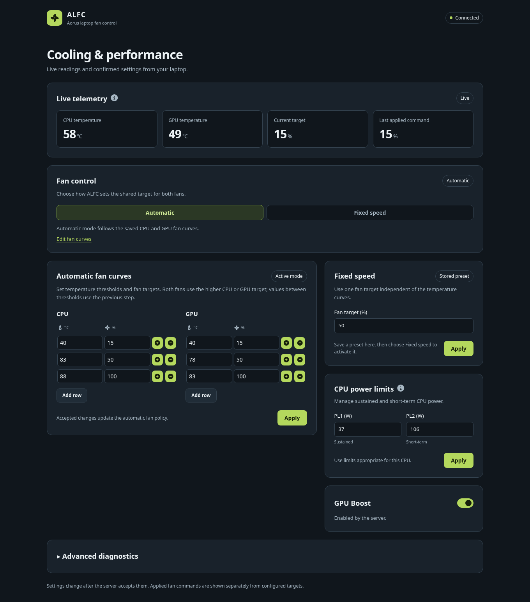
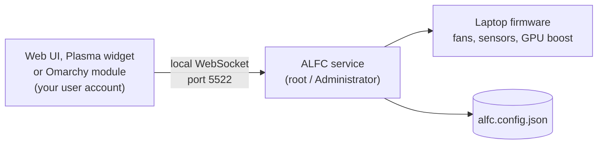

# Aorus Laptop Fan Control (ALFC)

[](https://github.com/ThatMarko/alfc/actions/workflows/ci.yml)
[](https://github.com/ThatMarko/alfc/blob/master/LICENSE)

ALFC controls the fans of compatible Gigabyte Aorus/Aero laptops on Linux and
Windows. A small background service talks to the laptop firmware, runs your fan
curves, and serves a local web dashboard. Optional desktop integrations add a
KDE Plasma 6 widget and an Omarchy status-bar module.

This fork builds on
[Andreas Opferkuch's original project](https://github.com/s-h-a-d-o-w/alfc).
The current implementation from [PR #1](https://github.com/ThatMarko/alfc/pull/1)
is merged into the default branch, `master`. Package metadata says `2.0.0`;
the latest published release, checked on 2026-11-06, is still the
[v2.0.0-alpha.7 prerelease](https://github.com/ThatMarko/alfc/releases/tag/v2.0.0-alpha.7),
which predates that merge. There is no stable release yet, and no laptop model
is certified.



The screenshot uses simulated readings; it is not a hardware validation result.

## How it works



- The **service** is the only part with hardware access. It checks every
  request, applies changes one at a time, saves your settings, and hands fan
  control back to the BIOS when it stops.
- The **clients** only display what the service reports and send requests to
  it. Several can be open at once; they all show the same state.
- Everything stays on your computer. The service listens on loopback
  addresses only (`127.0.0.1` and `::1`) and has no login, so it must not be
  exposed to a network.

[ARCHITECTURE.md](ARCHITECTURE.md) explains the design in detail.

## Hardware and platform support

The backend detects fan control, GPU boost, and CPU power tuning separately.
The web UI and widget use those runtime capabilities; a supported fan controller
does not establish CPU-tuning or GPU-boost support.

| Function                          | Linux                                              | Windows                                                               |
| --------------------------------- | -------------------------------------------------- | --------------------------------------------------------------------- |
| Fan control and temperature reads | `acpi_call`, with compatible firmware methods      | ABI 2 `WmiDll.dll`, with compatible vendor WMI provider               |
| GPU boost                         | Supported vendor ACPI method, when detected        | Supported vendor WMI method, when detected                            |
| CPU power limits                  | Writable Intel RAPL constraints, when detected     | Optional experimental CPUOC adapter; not included in release archives |
| Desktop integration               | KDE Plasma 6 widget; Omarchy 4.0.4 status/launcher | Use the web UI                                                        |

The bundled Intel SDK is a legacy managed .NET Framework assembly with additional
XTU/WCF dependencies. Its presence does **not** make the experimental .NET 8
NativeAOT CPUOC adapter deployable. NativeAOT publishing and actual driver
compatibility remain unverified; see [PORTING_REVIEW.md](PORTING_REVIEW.md).
Windows version alone does not determine whether CPU tuning works.

These are historical community reports from earlier ALFC implementations, not
certification of the current native bindings:

| Model        | Fan control reports  | CPU limit reports | GPU boost reports    |
| ------------ | -------------------- | ----------------- | -------------------- |
| Aorus 15G    | Windows 10/11, Linux | Windows 10, Linux | Windows 10/11, Linux |
| Aorus 15G XC | Windows 10, Linux    | Windows 10, Linux | Unconfirmed          |
| Aorus 15P XD | Windows 10           | Windows 10        | Unconfirmed          |
| Aorus 15 FSB | Windows 11           | Unconfirmed       | Unconfirmed          |
| Aorus 5 SE4  | Windows 11           | Unconfirmed       | Unconfirmed          |
| Aero 15 SA   | Windows 10/11, Linux | Unconfirmed       | Unconfirmed          |

Report the exact model, firmware, OS, driver, and ALFC revision when confirming
support. GPU boost methods are particularly model-dependent.

## Choose how you use ALFC

Every setup needs the service. The interfaces are optional and can be combined.

| Interface             | Use it when                                                    | Can change settings? | Guide                                    |
| --------------------- | -------------------------------------------------------------- | -------------------- | ---------------------------------------- |
| Web UI                | Always available, on any desktop, including Windows            | Yes, plus raw diagnostics | [OPERATIONS.md](OPERATIONS.md)      |
| KDE Plasma 6 widget   | You use KDE Plasma 6 on Linux and want controls in the panel or tray | Yes            | [plasmoid/README.md](plasmoid/README.md) |
| Omarchy bar module    | You use Omarchy 4.0.4 (Hyprland/Quickshell) and want status in the bar | No, opens the web UI | [OMARCHY.md](OMARCHY.md)        |

## Get started

1. **Read the safety notes below.**
2. **Install the service** for your system:
   - **Linux:** [LINUX.md](LINUX.md) covers the `acpi_call` kernel module,
     installation under `/opt/alfc`, a temporary foreground run, and removal.
     An Arch package template exists but is not published; see
     [aur/README.md](aur/README.md).
   - **Windows:** [WINDOWS.md](WINDOWS.md) covers the vendor WMI requirement,
     `install.bat`, a temporary run with `run.bat`, upgrades, and removal.
3. **Open `http://localhost:5522`** after the service log reports
   `Start finished`.
4. **Optionally add a desktop integration** as your normal user (not with
   `sudo`): the [Plasma widget](plasmoid/README.md) or the
   [Omarchy module](OMARCHY.md).

[OPERATIONS.md](OPERATIONS.md) explains configuration, what a healthy start
looks like, how to read the dashboard, and troubleshooting.

## Safety notes

- **Use one fan controller.** Do not run ALFC alongside other tools that write
  the same fan or power controls.
- **Review the configuration first.** Startup applies the saved fan mode, GPU
  boost setting and CPU power limits automatically. The shipped 37 W / 106 W
  limits are historical defaults, not recommendations for every CPU, and the
  accepted 0–200 W range is input validation, not a hardware safety rating.
- **Saved, commanded and measured are different.** A confirmed change means
  ALFC validated, applied and saved it. Fan speeds shown are the commanded
  target and the last command the firmware accepted, not measured RPM.
- **Stopping hands control back to the BIOS, with limits.** ALFC attempts the
  handoff within a bounded time. A hung firmware call or a forced kill can
  prevent it; check the log if fans behave unexpectedly after stopping.
- **Local only.** The WebSocket API has no authentication. Remote access and
  reverse proxies are unsupported.
- **Update check.** The web UI asks GitHub for a newer release when it
  connects and every 12 hours. Hardware control never needs Internet access.

## Development

Source development uses Bun 1.4.3 and Node.js 24.22.0 LTS (Node 24.11 or newer
within major 24 is the minimum). Bun runs the backend and manages
dependencies; Node runs Vite, Vitest and the other development tools. Release
executables embed Bun, so users install neither.

```bash
bun install --frozen-lockfile
bun run all-checks
```

Run the web UI as a normal user and the backend elevated, in two terminals:
`bun run --cwd frontend start` serves the UI on port 3000, and
`sudo bun run --cwd server start` runs the Linux backend on port 5522 (on
Windows, use an administrator terminal without `sudo`). Development runs load
the repository's `alfc.config.json` but never save to it.

[CONTRIBUTING.md](CONTRIBUTING.md) explains the toolchain, the repository
layout, hardware-free testing and pull requests.

## Documentation

**Using ALFC**

| Document                                             | Purpose                                                                  |
| ---------------------------------------------------- | ------------------------------------------------------------------------ |
| [LINUX.md](LINUX.md)                                 | Linux requirements, installation, upgrades, removal and troubleshooting  |
| [WINDOWS.md](WINDOWS.md)                             | Windows requirements, installation, upgrades, removal and troubleshooting |
| [OPERATIONS.md](OPERATIONS.md)                       | Configuration, healthy startup, dashboard states, diagnostics            |
| [plasmoid/README.md](plasmoid/README.md)             | KDE Plasma 6 widget installation, settings and behavior                  |
| [plasmoid/DEPENDENCIES.md](plasmoid/DEPENDENCIES.md) | Qt/KDE packages for the widget and its tests                             |
| [OMARCHY.md](OMARCHY.md)                             | Omarchy bar module setup and status meanings                             |
| [aur/README.md](aur/README.md)                       | Unpublished Arch package template and its maintenance                    |
| [SECURITY.md](SECURITY.md)                           | Vulnerability reporting and trust boundaries                             |

**Understanding and changing ALFC**

| Document                                             | Purpose                                                                  |
| ---------------------------------------------------- | ------------------------------------------------------------------------ |
| [ARCHITECTURE.md](ARCHITECTURE.md)                   | Components, request flow, startup and shutdown, data model               |
| [CONTRIBUTING.md](CONTRIBUTING.md)                   | Toolchain, repository orientation, checks and pull requests              |
| [common/PROTOCOL.md](common/PROTOCOL.md)             | WebSocket messages, validation and errors                                |
| [common/COMPATIBILITY.md](common/COMPATIBILITY.md)   | Client and protocol version compatibility                                |
| [RELEASING.md](RELEASING.md)                         | Build targets, release artifacts and release gates                       |
| [ROADMAP.md](ROADMAP.md)                             | Implemented scope and proposed work                                      |
| [MAINTENANCE_REVIEW.md](MAINTENANCE_REVIEW.md)       | Historical mainline review findings and checks                           |
| [PORTING_REVIEW.md](PORTING_REVIEW.md)               | Historical audit evidence, references and physical release gates         |
| [CODE_OF_CONDUCT.md](CODE_OF_CONDUCT.md)             | Community standards and contact                                          |
